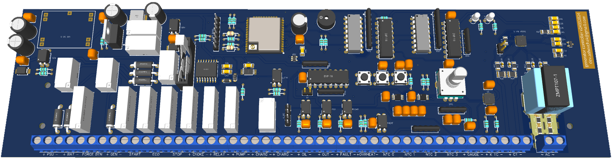

# genset-ctl-freertos

Firmware for an ESP32-based generator (genset) controller: automatic
start/stop state machine, shift-register relay I/O, sensor monitoring, a
web dashboard, WebSocket and MQTT interfaces, and a persistent FRAM event
journal. A second, mostly independent sub-project (`display/`) is an
ESP32-S3 + LVGL touch panel that talks to the controller over HTTP/WebSocket,
with an ESP-NOW fallback link and LAN auto-discovery for when the network
path isn't available.



## Hardware

- **Controller**: ESP32 (D0WD-Q5), 16MB flash, dual OTA app partitions.
  - Output shift register (`SN74HC595N`) drives ignition, starter, choke,
    fuel pump, load relay, charger, etc.
  - Input shift register (`CD4021BE`) reads protection signals (overload,
    oil, overheat, output-present, PSU/generator/battery sense, a jumper
    for recovery mode).
  - Sensors: 2x ADS1115 (ADC), INA233 (battery voltage), MCP9600
    (head-temperature thermocouple), MCP39F511A (AC power/energy meter over
    UART), a tachometer input, DS3231 RTC, an SSD1306 OLED + rotary encoder
    for local control, and an FM24V10 FRAM chip for the event journal.
- **Display panel** (optional, `display/`): ESP32-S3 with an LVGL touch
  screen, showing live state, a journal view, and remote-control hardware
  I/O (physical start/stop buttons, autostart trigger, status outputs).

> **A note on the bill of materials.** The component selection for this
> board was not driven by engineering merit, cost, or availability. It was
> driven by a pressing need to finally do *something* with a drawer full of
> aging parts that had been "too good to throw away" for years. If you are
> building your own, please do not treat this BOM as a recommendation:
> pick modern parts on purpose instead of inheriting someone else's
> stockpile by accident.

## Features

- Generator auto start/stop state machine with retry logic, emergency-stop
  classification, and configurable safety limits (temperature, power).
- Web dashboard (HTTP + WebSocket on port 80) with live gauges/charts,
  manual register control, and a WiFi/MQTT/safety-limits configuration page.
- MQTT publish/subscribe interface, including a ready-made Home Assistant
  integration package (`ha/`).
- A 4080-record FRAM event journal (engine runs, charge cycles, alarms,
  maintenance, system events) with a paged/filterable web UI and lifetime
  metrics (run hours, starts, max readings, maintenance-due tracking).
- OTA firmware updates with bootloader-level rollback-on-crash protection,
  plus a one-time, normally-disabled endpoint for updating the bootloader
  itself on units with no physical USB access (see `BOOTLOADER-UPDATE.md`).
- A display panel with its own live WebSocket view, journal browsing, and
  hardware remote start/stop/autostart I/O.
- An encrypted ESP-NOW link and LAN UDP discovery so the display panel can
  find and control a controller without typing in an IP, including a
  fallback path when the WiFi network itself is down (see `ESPNOW.md`).

## Repository layout

| Path | What it is |
|---|---|
| `idf/` | ESP-IDF/`idf.py` build for the main controller (the sole build system; see `CLAUDE.md` for the full build-command reference) |
| `*.cpp` / `*.h` (repo root) | The controller's own source: per-subsystem modules (state machine, web/WS, MQTT, FRAM journal, device drivers, ESP-NOW, ...) |
| `data/` | Web dashboard static files (HTML/JS/CSS), served from the controller's filesystem |
| `display/` | ESP32-S3 + LVGL touch-panel firmware (Arduino/`arduino-cli` build) |
| `ha/` | Home Assistant MQTT integration package |
| `mqtt/` | Local Mosquitto broker config for testing the MQTT interface without a real broker |
| `doc/` | Datasheets and reference material for the hardware this firmware drives |
| `doc/production/` | PCB production files for the GeneratorCTL tiny board: KiCad project export (schematic + routed 4-layer PCB) and the Gerber/drill set for fab ordering |
| `retired/` | Superseded scripts/sources kept for reference, not part of the active build |

## Building and flashing

Requires ESP-IDF (`source <idf_path>/export.sh`) for the controller, and
`arduino-cli` for the display panel. See `CLAUDE.md` for the full set of
build variants (debug/nodebug, bootloader-update) and `idf/sdkconfig.defaults`
for the non-default Kconfig options this project needs.

**Main controller:**
```sh
cd idf
./compile.sh          # idf.py build, then archives the binary
./flash.sh [port]     # USB flash
./burn.sh             # OTA update over HTTP (target read from repo-root `host`)
```

**Display panel:**
```sh
cd display
./compile.sh
./upload.sh [port]
```

There is no automated test suite — verification is: compile clean, then
flash to real hardware and exercise it over serial/HTTP. This firmware
drives a running internal-combustion generator; treat changes to the state
machine or safety-limit logic accordingly.

## Load and soak testing

`stress_test.py` (repo root, Python 3 standard library only) loads a running
controller over HTTP and WebSocket and reports whether it survived. Run it
against a test unit, not a controller that is driving a real generator.

```sh
./stress_test.py [host] --profile soak --ws-mute 1    # 8 h, moderate load
./stress_test.py [host] --profile burst               # 10 min, saturating
```

`host` defaults to the repo-root `host` file. Every profile value can be
overridden: `--duration`, `--http-workers`, `--http-delay`, `--ws-normal`,
`--ws-churn`, `--ws-mute`, `--churn-period`.

What it does:
- **HTTP workers** issue a weighted mix of read-only GETs: `/log`, filtered
  `/log?group=maint|alarm&count=50` (up to 400 FRAM reads per request),
  `/metrics`, and large static files.
- **WebSocket clients** come in three kinds: `normal` stays connected,
  `churn` reconnects every `--churn-period` seconds, and `mute` never answers
  pings, so the server's heartbeat has to drop it. No client ever sends a
  text frame, because a bare number sent over `/ws` toggles a relay.
- **A monitor** reads new journal events every 30 s and prints a status line
  with free heap, request count and WebSocket frame count.

A long run should not suspend the host machine, and its output belongs in a
file:

```sh
systemd-inhibit --what=sleep:idle --why="soak test" \
  nohup ./stress_test.py <host> --profile soak --ws-mute 1 \
  > soak-$(date +%Y%m%d-%H%M).log 2>&1 &
tail -f soak-*.log
```

`kill -INT <pid>` stops a run early and still prints the report; a plain
`kill` does not. Do not start a run within 10 minutes of an OTA update: a
reboot inside the confirmation window rolls the new image back.

The report lists per-endpoint latency (p50/p99/max), WebSocket counters,
free-heap drift between the first and last 10 % of samples, and any new
`boot`, `panic_summary`, `task_wdt` or `i2c_stuck` journal events. The last
line is the verdict:

| Verdict | Meaning | Exit status |
|---|---|---|
| `PASS` | no reboot, no crash event | 0 |
| `FAIL` | new `boot` event, WebSocket `UPTIME` went backwards, or a crash event | 1 |
| `INCONCLUSIVE` | the final journal read failed, or no WebSocket report arrived | 2 |

A free-heap drop of more than 8 KB adds a `WARN` to the verdict. HTTP
timeouts never count as a reboot, since network trouble on the client side
looks the same. `burst` saturates the single-threaded HTTP server, so
multi-second latency and delayed WebSocket reports are expected there; judge
it on reboots and crash events only.

## Interfaces

- **HTTP + WebSocket**: `http://<host>/` (dashboard), `ws://<host>/ws`
  (live state). See `CLAUDE.md`'s "Web/MQTT interfaces" section for the
  endpoint list.
- **MQTT**: topic structure, JSON schema and the state enum are documented
  in `MQTT.md`.
- **Home Assistant**: a ready-made MQTT package (entities, Lovelace
  dashboard, example automations) is in `ha/`, see `ha/README.md`.
- **ESP-NOW / LAN discovery**: wire format, provisioning and security model
  for the display panel's fallback link are in `ESPNOW.md`.
- **Bootloader update endpoint**: a rare, deliberately-disabled-by-default
  operation for USB-less units, documented in `BOOTLOADER-UPDATE.md`.

## Documentation

- `CLAUDE.md` — the detailed, continuously-maintained technical reference:
  full architecture, build internals, task layout, every subsystem, and the
  non-obvious gotchas found while building this. Written for contributors
  and AI coding assistants working in this repo.
- `MQTT.md`, `ESPNOW.md`, `BOOTLOADER-UPDATE.md`, `ha/README.md` — interface
  references for their respective subsystems.
- `display/README.md` — Arduino IDE board configuration for the display
  panel.

## License

MIT — see `LICENSE`.
